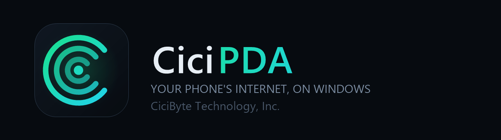
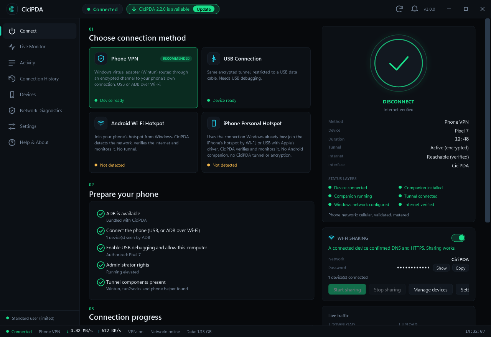
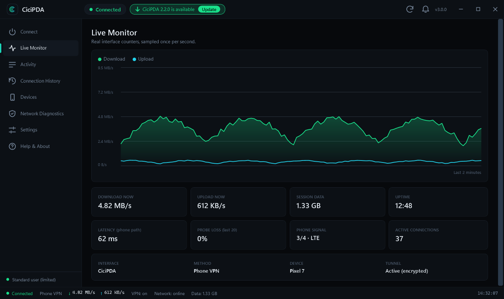
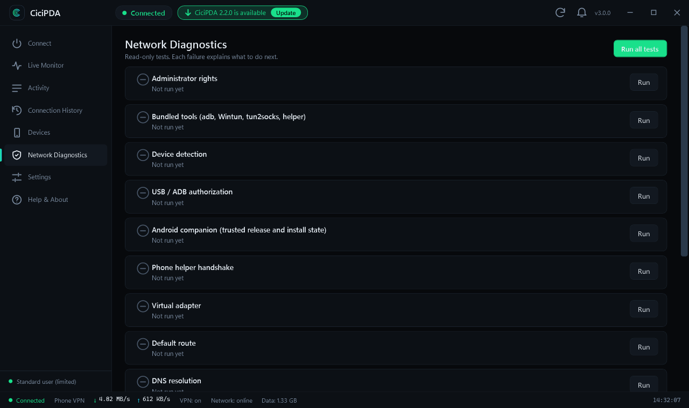
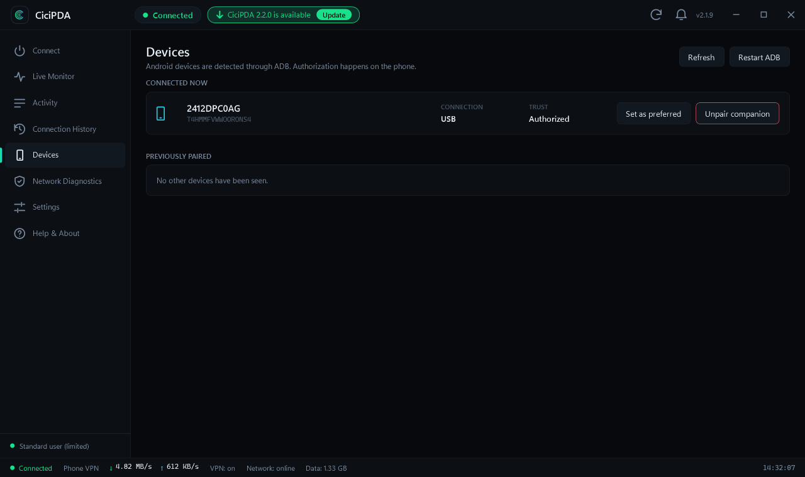
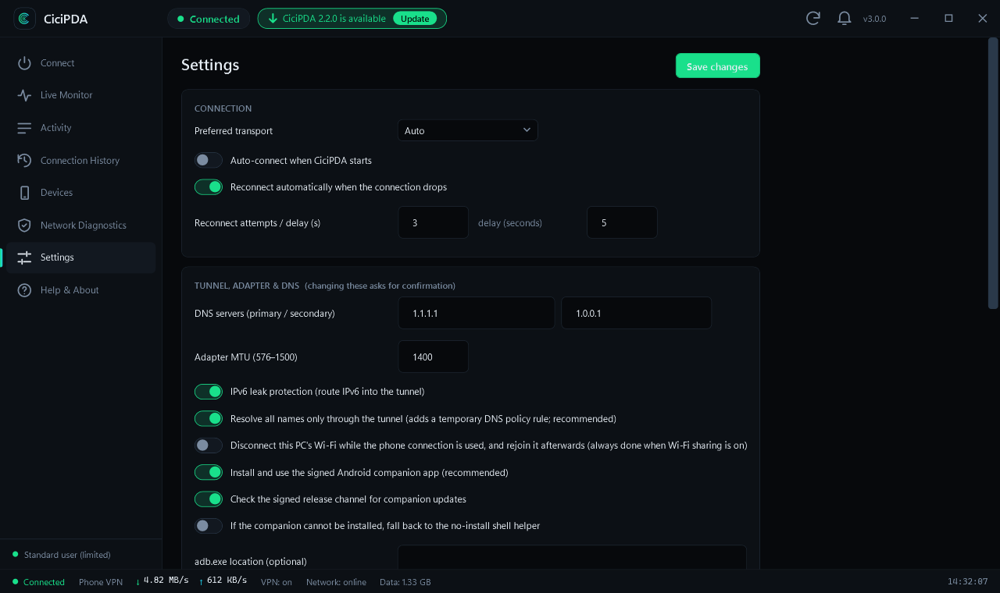
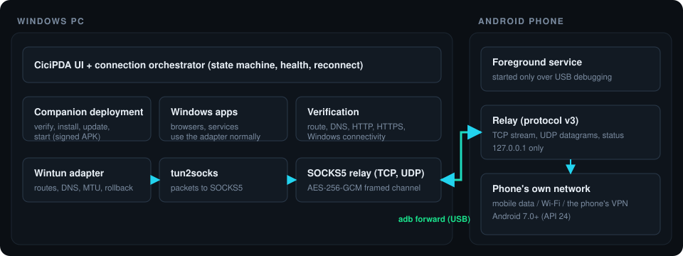

<div align="center">



**Use your phone's internet on your Windows PC — one app, real connectivity, verified.**

Connects an Android phone over USB, installs and updates its own signed companion app, builds an encrypted tunnel, configures a Windows virtual adapter, and only reports *Connected* once DNS, HTTP and HTTPS really work.

[](https://github.com/RealMrNovember/CiciPDA/releases/latest)


[](LICENSE)

[**Download**](https://pda.cicibyte.com) · [pda.cicibyte.com](https://pda.cicibyte.com) · [cicibyte.com](https://cicibyte.com) · [Documentation](docs/DEVELOPMENT.md) · [☕ Buy me a coffee](https://buymeacoffee.com/MikeRoss)

<br>



<sub>Interface preview rendered with sample values (the live app shows your real device, speeds and checks).</sub>

</div>

---

## Why CiciPDA

| | |
| --- | --- |
| **One-click setup** | Plug the phone in, approve *Allow USB debugging* once, press **Connect**. CiciPDA detects the device, installs or updates the Android companion, starts it, builds the tunnel and configures Windows. No APK hunting, no adb commands, no registry edits. |
| **Honest status** | Six separate indicators — device, companion installed, companion running, tunnel, Windows network, internet verified — instead of one misleading "Connected". Nothing is simulated and Windows' own connectivity status is never forged. |
| **Secure by construction** | Signed companion with a pinned signer certificate, signed release metadata, authenticated AES-256-GCM tunnel with fresh keys per connection, loopback-only listeners, secrets protected with Windows DPAPI. |
| **Reversible** | Every route, DNS and sharing change is non-persistent and journaled. Disconnect, close, crash or reboot — Windows returns to its previous network state. |
| **Self-updating** | The app and the Android companion update themselves from a signed release channel. You confirm before anything is installed. |

## Screenshots

<table>
  <tr>
    <td width="50%"><br><sub><b>Live Monitor</b> — real interface counters, latency, probe loss, session totals</sub></td>
    <td width="50%"><br><sub><b>Network Diagnostics</b> — every check explains the fix</sub></td>
  </tr>
  <tr>
    <td width="50%"><br><sub><b>Devices</b> — devices on your Wi-Fi hotspot (name, IP, MAC, your own names) plus connected and previously paired phones</sub></td>
    <td width="50%"><br><sub><b>Settings</b> — dangerous network changes ask for confirmation</sub></td>
  </tr>
</table>

## Installation

1. Download **`CiciPDA-<version>-windows-x64-Setup.exe`** from [Releases](https://github.com/RealMrNovember/CiciPDA/releases/latest) and run it. It installs to `C:\Program Files\CiciByte\CiciPDA` (the `CiciByte` folder is the vendor folder, `CiciPDA` is the application folder) with everything it needs (ADB, Wintun, the packet engine and the signed Android companion). There is no portable build.
2. Start **CiciPDA** — it runs as administrator because the virtual adapter, routes and DNS need it.
3. Connect your Android phone with a data cable and tap **Allow** on the *Allow USB debugging?* prompt.
4. Press **Connect**. First time only: confirm the companion install on the phone if it asks, and allow notifications so its sharing notice is visible.

> Releases are not yet Authenticode-signed, so Windows SmartScreen may warn on first run (*More info → Run anyway*). The installer's integrity is protected by a signed checksum used by the auto-updater.

Settings, history and logs live per user in `%LocalAppData%\CiciByte\CiciPDA`. Uninstall from *Apps & features*.

### Updates

CiciPDA checks the signed release channel shortly after start and every six hours (toggle in **Settings**), and the **refresh button in the header** checks on demand. When a new version exists a green **Update** pill appears in the header. Press it once: it shows the download percentage with a progress bar, then *Verifying* and *Installing*, and is disabled meanwhile so it cannot be pressed twice. The installer is downloaded only from GitHub, verified against a signed SHA-256, and run after you confirm — your connection is closed and your network settings restored first, and CiciPDA restarts afterwards (with the usual UAC prompt). The Android companion is updated the same way (signed metadata → hash → pinned signer certificate → Android's own signature check).

## What's new

See [CHANGELOG.md](CHANGELOG.md). Highlights of 3.0: the app **no longer closes itself** on Connect/Disconnect, it **hides to the system tray** while connected, it **remembers its window position**, it can **release the PC's Wi-Fi** while sharing, and the Devices page lists and names the **devices on your hotspot**. Earlier: **DNS fix**, the **Wi-Fi sharing** card, an **Update** button with progress and **Check for updates**.

## Platform support

| Platform | Status |
| --- | --- |
| **Windows 10 / 11 x64** | Supported (`CiciPDA-<version>-windows-x64-Setup.exe`) |
| **Android 7.0+** | Companion app, installed and updated automatically from the Windows app |
| **Linux** | Not available — the app depends on WPF, Wintun and `netsh` |
| **macOS** | Not available — same reason |

Release assets are named per platform so ports can be added later without renaming.

## Website

The project site is **[pda.cicibyte.com](https://pda.cicibyte.com)** (source in [`site/`](site/), plain HTML/CSS/JS, no build step). Its download button always resolves to the installer of the latest GitHub release. It is deployed to GitHub Pages by [`.github/workflows/pages.yml`](.github/workflows/pages.yml) whenever `site/` changes on `master`; the custom domain is the `site/CNAME` file plus a DNS `CNAME` record `pda` → `realmrnovember.github.io`.

## Connection methods

| Method | How it works | Encrypted by CiciPDA | Status |
| --- | --- | :---: | --- |
| **Phone VPN** *(recommended)* | Wintun adapter → tun2socks → SOCKS5 relay → authenticated channel over ADB → companion app → the phone's own connection (mobile data, Wi-Fi, or a VPN running on the phone). USB or ADB over Wi-Fi. | ✅ | Implemented · awaiting on-device validation |
| **USB Connection** | The same tunnel, restricted to a USB cable. | ✅ | Implemented · awaiting on-device validation |
| **Android Wi-Fi hotspot** | You join the phone's hotspot; CiciPDA detects it, verifies the internet and monitors the interface. No tunnel. | — | Implemented · awaiting validation |
| **iPhone Personal Hotspot** | Wi-Fi **or** Apple USB Ethernet adapter that Windows already provides; CiciPDA verifies and monitors it. **No Android companion and no CiciPDA tunnel.** | — | Implemented · awaiting validation |

Optional: **Wi-Fi sharing from the PC** through Windows Mobile Hotspot, controlled from the *Wi-Fi sharing* card on the Connect page. It is bound to the CiciPDA adapter only (never an unrelated connection), starts only after the internet has been verified, never takes over a hotspot you already run, and restores your previous hotspot name, password and band when it stops.

## How it works

<div align="center">

</div>

1. **Detect & authorize** — `adb devices`; USB-debugging consent is always the user's.
2. **Prepare the companion** — verify the signed release, install or update the APK, open it once on first run.
3. **Start the service** — a foreground service started over ADB with a fresh per-connection session key (sent through adb's stdin, never a PC command line; Keystore-wrapped on the phone and deleted on disconnect).
4. **Tunnel** — AES-256-GCM frames, keys derived per connection and direction from the session key plus fresh randomness from both sides (no nonce reuse, no replay).
5. **Windows networking** — Wintun adapter, address, DNS, MTU, split default routes (`0.0.0.0/1` + `128.0.0.0/1`), IPv6 leak protection, a pinned route for the transport host to prevent loops.
6. **Verify** — default route, DNS, HTTP, HTTPS and Windows connectivity status must pass before *Connected*; partial success is shown as *Limited Connectivity*.
7. **Monitor & recover** — live counters, authenticated health polling, automatic reconnect, ordered rollback.

Details: [protocol and limits](docs/PROTOCOL.md) · [Android companion & OEM notes](docs/ANDROID_COMPANION.md) · [release process](docs/RELEASE.md).

## Features

- **Runs in the system tray:** while a connection is active, the **X button hides CiciPDA to the tray** instead of closing it (tray menu: Open, Disconnect, Quit). Starting CiciPDA again brings the running window forward.
- **Remembers where you put the window** (position, size, maximised) and never restores it off-screen.
- **Wi-Fi handover:** your PC's Wi-Fi is released while the phone connection is used and rejoined afterwards (automatic when Wi-Fi sharing is on, or switch it on in Settings). Journaled, so a crash or restart rejoins it too.
- **Devices on your hotspot** (Devices page): name, IP and MAC of every device that joined, how long it has been connected, names you choose, copy IP/MAC, and *Change password and disconnect all* (Windows Mobile Hotspot has no per-device block, so a new password is the supported way to remove devices).
- **Wi-Fi sharing card** on the Connect page: on/off switch, network name, masked password with Show/Copy, live state (waiting for a verified connection → starting → active → device connected → device internet verified, or the exact reason it is unavailable), connected-device count and Start/Stop buttons
- Connect · Live Monitor · Activity · Connection History · Devices · Network Diagnostics · Settings · Help
- Real-time download/upload, session totals, latency, probe loss, uptime, phone signal and network type
- 14 diagnostic tests with plain-language results and suggested fixes
- Local, persistent connection history and a severity-tagged activity feed (secrets are masked)
- Keyboard shortcuts: `Ctrl+1…8` pages, `Ctrl+Enter` connect/disconnect, `F5` refresh devices
- English and Turkish interface, two themes
- Header controls: connection state, **Update** pill with progress, **Check for updates**, notifications, version

## Security & privacy

- Signed companion APK; signer certificate **pinned** in the app; release metadata signed with an offline ECDSA key — a hash from the download server alone is never trusted.
- Only standard primitives (AES-GCM, HMAC-SHA256, ECDSA P-256); no custom cryptography.
- Relay and SOCKS listeners bind to `127.0.0.1` only; no inbound firewall openings are added.
- No long-lived pairing secret: every connection uses a fresh session key that is never written to the PC's disk, travels to the phone through adb's stdin, is wrapped by the Android Keystore on the phone, and is deleted on disconnect or "Unpair companion". The hotspot passphrase is protected with Windows DPAPI. Secrets are masked in logs. See [docs/PROTOCOL.md](docs/PROTOCOL.md).
- All external commands use explicit argument lists. No registry networking changes, no TTL changes.
- CiciPDA is for legitimate connectivity. It does **not** disguise traffic or evade carrier policies — use it with your own phone and within your plan's terms. The app sends no telemetry.

## Known limitations

- Not a full layer-3 VPN and **not WireGuard**: TCP and UDP datagrams are relayed (Windows DNS is ordinary UDP/53 sent through the phone to the DNS servers in Settings); ICMP (ping) is not carried; IP fragments are dropped. IPv6 is routed into the tunnel only when leak protection is on and works only if the phone's network has IPv6. iPhone and hotspot-join modes are not encrypted by CiciPDA.
- Android may stop background apps on aggressive battery managers; CiciPDA detects it and reconnects. See the [OEM notes](docs/ANDROID_COMPANION.md).
- **Hardware status:** on a real Android 16 phone and a real Windows PC the connection, the verified internet access, Wi-Fi sharing and a second device joining the hotspot have been reported working by the project owner. A systematic run of the [hardware test plan](docs/HARDWARE_TEST_PLAN.md) (Windows 10 and 11, several phone vendors, iPhone, IPv6, QUIC, recovery cases) has **not** been completed yet. The automated suite (137 tests, including the real Java relay and the real bundled `tun2socks.exe`/`netsh` command lines) cannot replace it; the checklist is in [docs/HARDWARE_TEST_PLAN.md](docs/HARDWARE_TEST_PLAN.md) and the honest status is in [docs/DEVELOPMENT.md](docs/DEVELOPMENT.md).

## Build from source

Requirements: Windows 10/11 x64, .NET 9 SDK; for the Android part the Android SDK build-tools and a JDK.

```powershell
git clone https://github.com/RealMrNovember/CiciPDA.git
cd CiciPDA\src\app
.\fetch-tools.ps1                 # wintun.dll + tun2socks.exe into tools\ (hash-checked)
cd ..\agent; .\build.ps1          # companion APK + legacy helper (dev keystore unless release keys exist)
cd ..\..
dotnet build src\app\CiciPDA.csproj -c Release
dotnet test tests\CiciPDA.Tests
installer\build-installer.ps1     # needs Inno Setup 6; validates the real publish folder and installer
```

Repository layout: `src/core` (all logic) · `src/app` (WPF UI) · `src/agent` (Android companion + relay) · `tests` · `installer` · `tools/ReleaseSigner` · `third_party/adb` · `docs`.

## Türkçe özet

CiciPDA, Android telefonunuzun internetini Windows bilgisayarınızda kullanmanızı sağlar. Kurulumdan sonra telefonu USB ile bağlayıp **USB hata ayıklamaya izin ver** dedikten sonra **Connect**'e basmanız yeterlidir; uygulama telefondaki imzalı yardımcı uygulamayı kendisi kurar/günceller, şifreli tüneli açar, Windows ağını yapılandırır ve DNS/HTTP/HTTPS gerçekten çalışmadan "Bağlı" göstermez. Kurulum `C:\Program Files\CiciByte\CiciPDA` altına yapılır, güncellemeler imzalı sürüm kanalından otomatik denetlenir ve siz onaylayınca kurulur.

## Support the project

<a href="https://buymeacoffee.com/MikeRoss"></a>

## Acknowledgements & licences

Built on [Wintun](https://www.wintun.net), [tun2socks](https://github.com/xjasonlyu/tun2socks) and Google's Android Debug Bridge. CiciPDA's own code is MIT-licensed ([LICENSE](LICENSE)); bundled components keep their licences ([THIRD_PARTY.md](THIRD_PARTY.md)). CiciPDA is developed by **CiciByte Technology, Inc.** ([cicibyte.com](https://cicibyte.com)) and is an independent project, not affiliated with PdaNet. All trademarks belong to their owners.
