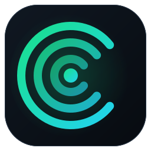

<div align="center">



# CiciPDA

**Use your phone's internet on your Windows PC — one app, real connectivity, verified.**

Connects an Android phone over USB, installs and updates its own signed companion app, builds an encrypted tunnel, configures a Windows virtual adapter, and only reports *Connected* once DNS, HTTP and HTTPS really work.

[](https://github.com/RealMrNovember/CiciPDA/releases/latest)


[](LICENSE)

[**Download**](https://github.com/RealMrNovember/CiciPDA/releases/latest) · [Documentation](docs/DEVELOPMENT.md) · [☕ Buy me a coffee](https://buymeacoffee.com/MikeRoss)

<br>


<sub>Interface preview rendered with sample values (the live app shows your real device, speeds and checks).</sub>

</div>

---

## Why CiciPDA

| | |
| --- | --- |
| **One-click setup** | Plug the phone in, approve *Allow USB debugging* once, press **Connect**. CiciPDA detects the device, installs or updates the Android companion, starts it, builds the tunnel and configures Windows. No APK hunting, no adb commands, no registry edits. |
| **Honest status** | Six separate indicators — device, companion installed, companion running, tunnel, Windows network, internet verified — instead of one misleading "Connected". Nothing is simulated and Windows' own connectivity status is never forged. |
| **Secure by construction** | Signed companion with a pinned signer certificate, signed release metadata, authenticated AES-256-GCM tunnel with fresh keys per connection, loopback-only listeners, secrets protected with Windows DPAPI. |
| **Reversible** | Every route, DNS and sharing change is non-persistent and journaled. Disconnect, close, crash or reboot — Windows returns to its previous network state. |
| **Self-updating** | The app and the Android companion update themselves from a signed release channel. You confirm before anything is installed. |

## Screenshots

<table>
  <tr>
    <td width="50%"><br><sub><b>Live Monitor</b> — real interface counters, latency, probe loss, session totals</sub></td>
    <td width="50%"><br><sub><b>Network Diagnostics</b> — every check explains the fix</sub></td>
  </tr>
  <tr>
    <td width="50%"><br><sub><b>Devices</b> — connected and previously paired phones, trust status</sub></td>
    <td width="50%"><br><sub><b>Settings</b> — dangerous network changes ask for confirmation</sub></td>
  </tr>
</table>

## Installation

1. Download **`CiciPDA-Setup-<version>.exe`** from [Releases](https://github.com/RealMrNovember/CiciPDA/releases/latest) and run it. It installs to `C:\Program Files\CiciByte` with everything it needs (ADB, Wintun, the packet engine and the signed Android companion). There is no portable build.
2. Start **CiciPDA** — it runs as administrator because the virtual adapter, routes and DNS need it.
3. Connect your Android phone with a data cable and tap **Allow** on the *Allow USB debugging?* prompt.
4. Press **Connect**. First time only: confirm the companion install on the phone if it asks, and allow notifications so its sharing notice is visible.

> Releases are not yet Authenticode-signed, so Windows SmartScreen may warn on first run (*More info → Run anyway*). The installer's integrity is protected by a signed checksum used by the auto-updater.

Settings, history and logs live per user in `%LocalAppData%\CiciByte\CiciPDA`. Uninstall from *Apps & features*.

### Updates

CiciPDA checks the signed release channel shortly after start and every six hours (toggle in **Settings**). When a new version exists an **Update** button appears; the installer is downloaded only from GitHub, verified against a signed SHA-256, and run after you confirm — your connection is closed and your network settings restored first. The Android companion is updated the same way (signed metadata → hash → pinned signer certificate → Android's own signature check).

## Connection methods

| Method | How it works | Encrypted by CiciPDA | Status |
| --- | --- | :---: | --- |
| **Phone VPN** *(recommended)* | Wintun adapter → tun2socks → SOCKS5 relay → authenticated channel over ADB → companion app → the phone's own connection (mobile data, Wi-Fi, or a VPN running on the phone). USB or ADB over Wi-Fi. | ✅ | Implemented · awaiting on-device validation |
| **USB Connection** | The same tunnel, restricted to a USB cable. | ✅ | Implemented · awaiting on-device validation |
| **Android Wi-Fi hotspot** | You join the phone's hotspot; CiciPDA detects it, verifies the internet and monitors the interface. No tunnel. | — | Implemented · awaiting validation |
| **iPhone Personal Hotspot** | Wi-Fi **or** Apple USB Ethernet adapter that Windows already provides; CiciPDA verifies and monitors it. **No Android companion and no CiciPDA tunnel.** | — | Implemented · awaiting validation |

Optional: **Wi-Fi sharing from the PC** through Windows Mobile Hotspot, bound to the CiciPDA adapter only (never an unrelated connection), started only after internet verification.

## How it works

<div align="center">

</div>

1. **Detect & authorize** — `adb devices`; USB-debugging consent is always the user's.
2. **Prepare the companion** — verify the signed release, install or update the APK, open it once on first run.
3. **Start the service** — a foreground service started over ADB; the pairing key travels through stdin, never a command line.
4. **Tunnel** — AES-256-GCM frames, keys derived per connection and direction from the pairing key plus fresh randomness from both sides (no nonce reuse, no replay).
5. **Windows networking** — Wintun adapter, address, DNS, MTU, split default routes (`0.0.0.0/1` + `128.0.0.0/1`), IPv6 leak protection, a pinned route for the transport host to prevent loops.
6. **Verify** — default route, DNS, HTTP, HTTPS and Windows connectivity status must pass before *Connected*; partial success is shown as *Limited Connectivity*.
7. **Monitor & recover** — live counters, authenticated health polling, automatic reconnect, ordered rollback.

Details: [protocol and limits](docs/PROTOCOL.md) · [Android companion & OEM notes](docs/ANDROID_COMPANION.md) · [release process](docs/RELEASE.md).

## Features

- Connect · Live Monitor · Activity · Connection History · Devices · Network Diagnostics · Settings · Help
- Real-time download/upload, session totals, latency, probe loss, uptime, phone signal and network type
- 13 diagnostic tests with plain-language results and suggested fixes
- Local, persistent connection history and a severity-tagged activity feed (secrets are masked)
- Keyboard shortcuts: `Ctrl+1…8` pages, `Ctrl+Enter` connect/disconnect, `F5` refresh devices
- English and Turkish interface, two themes

## Security & privacy

- Signed companion APK; signer certificate **pinned** in the app; release metadata signed with an offline ECDSA key — a hash from the download server alone is never trusted.
- Only standard primitives (AES-GCM, HMAC-SHA256, ECDSA P-256); no custom cryptography.
- Relay and SOCKS listeners bind to `127.0.0.1` only; no inbound firewall openings are added.
- Hotspot passphrases and the pairing key are protected with Windows DPAPI and masked in logs.
- All external commands use explicit argument lists. No registry networking changes, no TTL changes.
- CiciPDA is for legitimate connectivity. It does **not** disguise traffic or evade carrier policies — use it with your own phone and within your plan's terms. The app sends no telemetry.

## Known limitations

- Not a full layer-3 VPN and **not WireGuard**: TCP and UDP datagrams are relayed; ICMP (ping) is not carried; IP fragments are dropped. iPhone and hotspot-join modes are not encrypted by CiciPDA.
- Android may stop background apps on aggressive battery managers; CiciPDA detects it and reconnects. See the [OEM notes](docs/ANDROID_COMPANION.md).
- Validation on physical phones is still in progress; the automated suite (75 tests, including a real Java relay over loopback) cannot replace it. See [what is and is not tested](docs/DEVELOPMENT.md).

## Build from source

Requirements: Windows 10/11 x64, .NET 9 SDK; for the Android part the Android SDK build-tools and a JDK.

```powershell
git clone https://github.com/RealMrNovember/CiciPDA.git
cd CiciPDA\src\app
.\fetch-tools.ps1                 # wintun.dll + tun2socks.exe into tools\ (hash-checked)
cd ..\agent; .\build.ps1          # companion APK + legacy helper (dev keystore unless release keys exist)
cd ..\..
dotnet build src\app\CiciPDA.csproj -c Release
dotnet test tests\CiciPDA.Tests
installer\build-installer.ps1     # needs Inno Setup 6; validates the real publish folder and installer
```

Repository layout: `src/core` (all logic) · `src/app` (WPF UI) · `src/agent` (Android companion + relay) · `tests` · `installer` · `tools/ReleaseSigner` · `third_party/adb` · `docs`.

## Türkçe özet

CiciPDA, Android telefonunuzun internetini Windows bilgisayarınızda kullanmanızı sağlar. Kurulumdan sonra telefonu USB ile bağlayıp **USB hata ayıklamaya izin ver** dedikten sonra **Connect**'e basmanız yeterlidir; uygulama telefondaki imzalı yardımcı uygulamayı kendisi kurar/günceller, şifreli tüneli açar, Windows ağını yapılandırır ve DNS/HTTP/HTTPS gerçekten çalışmadan "Bağlı" göstermez. Kurulum `C:\Program Files\CiciByte` altına yapılır, güncellemeler imzalı sürüm kanalından otomatik denetlenir ve siz onaylayınca kurulur.

## Support the project

<a href="https://buymeacoffee.com/MikeRoss"></a>

## Acknowledgements & licences

Built on [Wintun](https://www.wintun.net), [tun2socks](https://github.com/xjasonlyu/tun2socks) and Google's Android Debug Bridge. CiciPDA's own code is MIT-licensed ([LICENSE](LICENSE)); bundled components keep their licences ([THIRD_PARTY.md](THIRD_PARTY.md)). CiciPDA is an independent project and is not affiliated with PdaNet. All trademarks belong to their owners.
